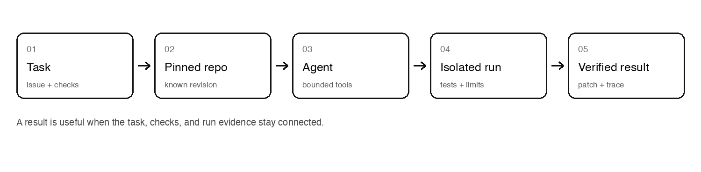

<div align="center">
  
  <p><strong>Give coding agents a task. Keep the proof.</strong></p>
  <p><a href="https://anvitdevadiga.github.io/tender/">Live demo</a> · <a href="https://github.com/AnvitDevadiga/tender">Source</a></p>
</div>

Tender is a local-first platform for evaluating coding agents. It gives an agent a repository task, runs its proposed changes in a controlled workspace, checks the result, and records what happened.



## What it records

- Whether the task passed and whether existing behavior regressed
- The patch, test results, run timeline, and failure category
- Runtime, token counts, and provider-reported cost when available
- Task, repository revision, and experiment configuration for reproducibility

## Try it locally

Requirements: Python 3.12 or newer. Docker is needed for isolated Docker runs. A model API key is only needed for real hosted-model calls; the offline test suite and benchmark validation work without one.

```bash
python3 -m venv .venv
source .venv/bin/activate
python -m pip install -e '.[dev]'
python3 scripts/prepare_fixtures.py
python -m tender validate-benchmark \
  --manifest experiments/retry-ablation-v1.toml \
  --dataset benchmarks/tasks.jsonl
```

To use Groq, set `GROQ_API_KEY` in your local environment, then run `python -m tender check-groq`. Never commit `.env` or API keys.

Start the local API and run explorer:

```bash
uvicorn tender.api:app --reload
```

Open [http://127.0.0.1:8000/dashboard](http://127.0.0.1:8000/dashboard). For Docker-backed queued runs, see [Local deployment](docs/DEPLOYMENT.md) and [Security](docs/SECURITY.md). The API is a development prototype; it is not a public arbitrary-code execution service.

## Live demo and current evidence

The [public demo](https://anvitdevadiga.github.io/tender/) replays a recorded run. It does not accept tasks or execute submitted code. The paired retrieval-cap experiment planned 60 trials across 30 tasks and five pinned repositories, but provider quota and tool-call errors left only five clean task pairs. Those pairs showed no solve-rate gain from the smaller context cap, so they do not support an efficiency claim. Read the [experiment report](docs/experiments/retrieval-cap-ab-v1.md), [raw results](docs/experiments/retrieval-cap-ab-v1.json), and earlier [provider trial notes](docs/PROVIDER_TRIALS.md). Token-cost figures are published-rate estimates, not billing records.

## Project map

- `src/tender/` — API, workflow, providers, sandbox, persistence, and benchmark runner
- `benchmarks/` and `experiments/` — pinned tasks and experiment configurations
- `dashboard/` — local run explorer
- `demo/` — read-only public portfolio demo
- `docs/` — architecture, evaluation contract, security, and operating notes
- `assets/` — monochrome brand and diagram assets (SVG and transparent PNG)

## Checks

```bash
ruff check src tests
ruff format --check src tests
pytest -q
```

Tender is an evolving research prototype. See [the implementation plan](docs/IMPLEMENTATION_PLAN.md) for remaining work and [the evaluation contract](docs/evaluation-contract.md) for what the measurements mean.
