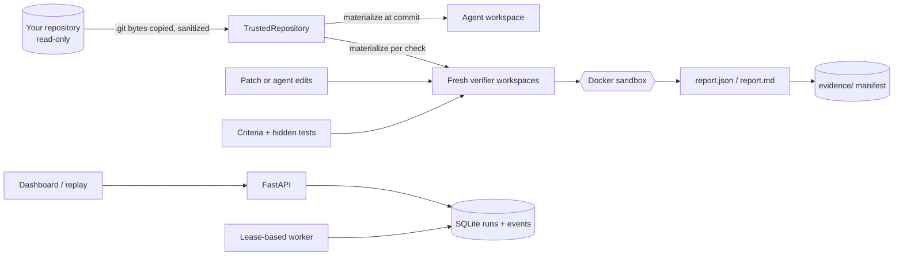

<div align="center">
  
  <p><strong>Verify AI-generated code before you trust it.</strong></p>
  <p><a href="https://anvitdevadiga.github.io/Tender/">Live demo</a> · <a href="https://anvitdevadiga.github.io/Tender/replay/">Recorded replay</a> · <a href="docs/PATCH_VERIFICATION.md">Verify a patch</a> · <a href="docs/SECURITY.md">Security</a></p>
</div>

# Tender

Tender independently verifies code changes produced by coding agents, or by anyone else. You give it a local repository, a pinned base commit, a patch, and acceptance criteria written before the patch ran. It applies the patch in fresh, isolated workspaces, runs your target and regression checks, and writes a report plus a hash-sealed evidence bundle of what happened.

It can also run its own bounded agent loop against pinned benchmark tasks and record every step, so you can compare models and configurations on evidence rather than claims.

## What Tender does

- **Verifies a patch** (`tender verify-patch`): validation, baseline, target checks, regression checks, integrity enforcement, report, evidence.
- **Runs an agent on a task** (API + worker, or the benchmark runner): plan, edit through authorized tools, test, verify in a pristine workspace, record.
- **Keeps evidence**: every command, exit code, output tail, digest, stage duration, and event, with `recorded`, `derived`, and `unknown` kept distinct.
- **Shows it**: a local dashboard for runs and reports; a read-only replay of recorded data on GitHub Pages.

## Why independent verification matters

An agent's statement that a change works is not evidence, and neither is a test run inside the agent's own workspace. That workspace can contain leftovers from earlier attempts, weakened tests, or a `conftest.py` that turns every failure into a pass. Tender judges a patch only where the patch cannot reach the judge:

- each check runs in a new workspace built from Git objects at the exact base commit;
- test files and test-runner configuration are reset to the base commit before checks run;
- hidden evaluator tests are added only after the patch is applied and never shown to the candidate;
- patches that touch protected paths, or add modules that shadow the test tooling, are rejected before anything runs;
- named tests must appear as passed in a JUnit report, so exiting with status 0 is not enough.

## Core capabilities

| Area | What exists |
| --- | --- |
| Repository boundary | Never runs Git against untrusted `.git` metadata; sanitized copies, no hooks, no helpers; ignored files never copied |
| Commit identity | Requested and executed commits recorded; mismatches rejected before any provider call |
| Pristine verification | Fresh workspace per check; pre-patch fingerprint recorded; directories removed afterwards |
| Tool authorization | Allowlist enforced at dispatch; refusals recorded; `run_command` never implicit |
| Outcomes | Separate target, regression, integrity, environment, provider, timeout, policy, overall |
| Reliability | Lease-fenced events, artifacts, and results; cancellable deadlines; whole-database metrics |
| Evidence | Per-file SHA-256 manifests; source vs derived; sanitized; verifiable (`tender evidence verify`) |
| Experiments | Seeded/counterbalanced trials, exclusions, quota-aware stopping, live-provider budgets, Wilson intervals, matched comparisons |
| Interface | Monochrome dashboard and replay: runs, inspector, diff viewer, compare, reports, keyboard navigation |

## Architecture



Details: [Architecture](docs/ARCHITECTURE.md) · [Agent workflow](docs/AGENT_WORKFLOW.md) · [Evaluation contract](docs/evaluation-contract.md).

## Quick start

Requirements: Python 3.12+, Git. Docker for untrusted code. No model API key is needed for patch verification or the test suite.

```bash
git clone https://github.com/AnvitDevadiga/Tender.git
cd Tender
python3 -m venv .venv && source .venv/bin/activate
pip install -e '.[dev]'
python scripts/prepare_fixtures.py      # deterministic benchmark fixtures
pytest -q                               # offline test suite (Docker tests skip without a daemon)

docker build -f Dockerfile.sandbox -t tender-sandbox:local .   # sandbox image with pytest
python scripts/run_patch_demo.py        # failure-and-repair demo; uses Docker when available
```

Start the API and dashboard:

```bash
TENDER_REPORT_ROOT=demo/data/patch-demo uvicorn tender.api:app
open http://127.0.0.1:8000/dashboard/
```

## Verify a local patch

```bash
git -C ~/code/project diff > fix.patch          # or a patch exported from any agent
export TENDER_SANDBOX_IMAGE=tender-sandbox:local
tender verify-patch \
  --repo ~/code/project --base HEAD \
  --patch fix.patch --criteria tender-criteria.toml \
  --out reports/fix-1
tender report render reports/fix-1/report.json  # Markdown for code review
tender evidence verify reports/fix-1/evidence   # recompute every hash
```

Exit status: `0` accepted, `1` rejected, `2` not evaluated (error or inconclusive). Criteria format, the meaning of every check, and the trust flags are in [Patch verification](docs/PATCH_VERIFICATION.md). The original repository is never modified; Tender re-checks it after the run and reports whether it changed.

## Evaluation methodology

- **Accepted** requires the target checks to pass in a pristine workspace, integrity to pass, and regression checks to pass or be explicitly *not configured*. In that last case the report says regression preservation was not measured.
- **Rejected** means a check failed or the patch violated policy. **Error** means the environment could not run the checks (for example, no Docker). **Inconclusive** means a time limit was reached. A provider quota error is not a coding failure, and a setup failure is not an incorrect patch.
- The **baseline** runs the target checks on the unpatched base. If they already pass, the report says they do not show that the patch is needed.
- Experiments exclude provider and environment failures from solve rates and list them, report Wilson intervals, and compare configurations task by task.

Full rules: [Evaluation contract](docs/evaluation-contract.md).

## Results and limitations

The published experiments are small and are reported with their limits; the landing page reads its numbers directly from these files:

- [Retry ablation](docs/experiments/groq-retry-ablation-3tasks-v1.json): 18 trials over 3 synthetic tasks, all passed on the first attempt. It therefore says nothing about whether retries help, and its "regression" figure only re-ran target assertions on a clean copy ([erratum E6](docs/EVALUATION_ERRATA.md)).
- [Retrieval-cap A/B](docs/experiments/retrieval-cap-ab-v1.md): 60 planned trials, 49 provider failures, 5 clean matched pairs, no difference. It is not evidence of capability or efficiency.
- The [patch demo](demo/data/patch-demo/index.json) involves no model. It shows Tender rejecting a plausible patch that breaks an existing test and accepting the corrected one.

Defects found in earlier versions and their effect on old records are in the dated [evaluation errata](docs/EVALUATION_ERRATA.md). Historical records are unchanged; the tests compare them byte for byte with the audited commit.

## Reproducibility

```bash
python scripts/prepare_fixtures.py         # fixture commits have fixed authors and dates
python scripts/run_patch_demo.py           # regenerate demo reports (timestamps/durations differ)
python scripts/record_replay.py --check    # replay must rebuild byte-for-byte from committed inputs
bash scripts/build_demo_site.sh /tmp/site  # the exact static site GitHub Pages serves
```

**Recorded** values were written by Tender while a run executed. **Derived** values are computed from recorded ones or sanitized for publication. **Unknown** values were never captured and are shown as unknown, never as zero. The public replay was rebuilt from 587 recorded events exported from the original run databases. An earlier version reconstructed events and copied values from another run ([erratum E8](docs/EVALUATION_ERRATA.md)).

## Security boundaries

- **Runs on your machine:** Tender itself, including Git plumbing on sanitized metadata copies, patch validation, and report writing. It never runs repository code.
- **Runs in Docker:** setup, baseline, target, regression, and agent commands, with no network, all capabilities dropped, a read-only root, UID 65532, and CPU, memory, PID, and time limits.
- **Runs on GitHub Pages:** nothing. The demo renders recorded JSON.

Not guaranteed: the code under test runs in the same process as the test runner, so a patch designed to forge results can still mislead a check. Docker depends on a privileged host daemon. The local backend (`--trust-local-execution`) is not isolation. Evidence is hashed, not signed. Remote repositories and pull-request execution are disabled. The API is a local tool with an optional shared-secret token, not a multi-user service. See [Security](docs/SECURITY.md).

## Live demo

- [Landing page](https://anvitdevadiga.github.io/Tender/): proposition, the failure-and-repair demo, results, limitations.
- [Recorded replay](https://anvitdevadiga.github.io/Tender/replay/): the real dashboard bundle over 19 recorded runs and 2 patch reports, served from a static snapshot. Nothing executes, and actions that would change state are refused.

## Documentation

| Document | Contents |
| --- | --- |
| [Patch verification](docs/PATCH_VERIFICATION.md) | Criteria reference, checks, reports, trust flags |
| [Architecture](docs/ARCHITECTURE.md) | Components, data flow, trust boundaries |
| [Evaluation contract](docs/evaluation-contract.md) | What each outcome means and what may be claimed |
| [Evaluation errata](docs/EVALUATION_ERRATA.md) | Dated defects and how to read old records |
| [Security](docs/SECURITY.md) | Threat model, controls, known limitations |
| [Deployment](docs/DEPLOYMENT.md) | Prerequisites, environment variables, Docker, worker |
| [Benchmarks](docs/BENCHMARKS.md) | Task schema, runner, experiment design |
| [Current state](docs/CURRENT_STATE.md) | What is implemented, verified, and open |

## Checks

```bash
ruff check src tests scripts && ruff format --check src tests scripts
pytest -q
node --test tests/js/diff.test.mjs
```

Tender has no license file yet, so default copyright applies until one is chosen.
