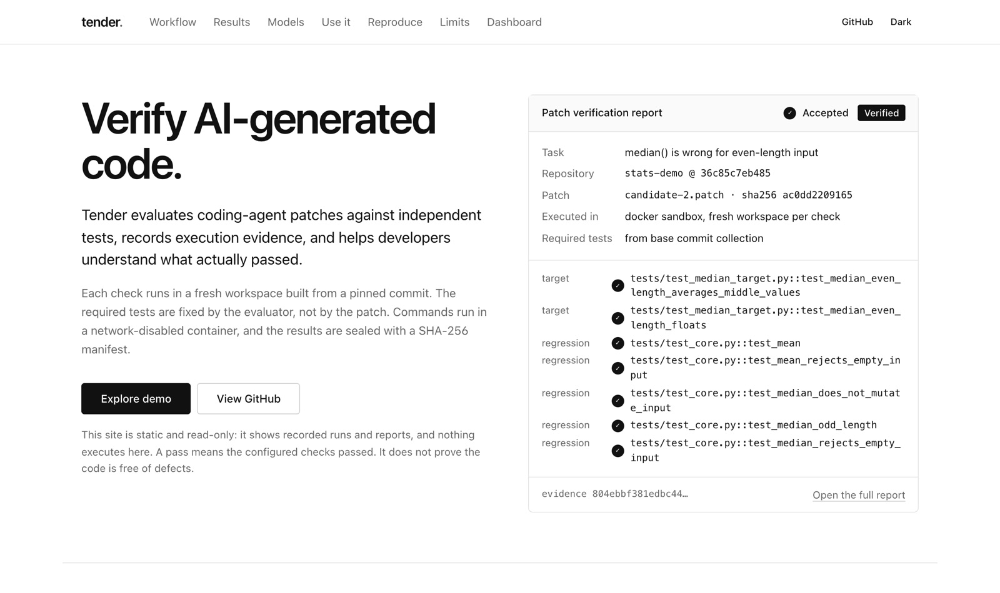
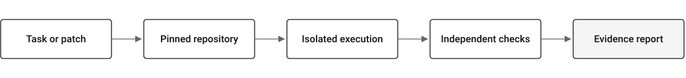

<p>
  <picture>
    <source media="(prefers-color-scheme: dark)" srcset="assets/tender-logo-dark.svg">
    
  </picture>
</p>

**Test AI-written code. See what actually passes.**

Tender evaluates coding-agent patches against independent tests. Each check runs in a fresh, isolated workspace built from a pinned commit, with required tests the patch cannot change. Every run leaves an inspectable report and a hash-sealed evidence bundle.

[Live demo](https://anvitdevadiga.github.io/Tender/) · [Recorded replay](https://anvitdevadiga.github.io/Tender/replay/) · [Patch verification](docs/PATCH_VERIFICATION.md) · [Security](docs/SECURITY.md)

## Live demo

**https://anvitdevadiga.github.io/Tender/**



The site is static and read-only. It shows recorded runs and reports, and nothing executes there. The evaluation engine runs locally.

## What Tender does

- **Pinned repository verification.** It verifies against an exact base commit, materialized from Git objects, and never trusts the repository's own Git configuration or hooks.
- **Isolated patch execution.** Setup and test commands run in Docker with no network, all capabilities dropped, a read-only root, and resource limits.
- **Independent checks.** Baseline, target, and regression checks each get a fresh workspace. The evaluator fixes the required tests before the patch runs, and each one must appear as passed in the JUnit report.
- **Evidence reports.** Each run writes `report.json`, a Markdown summary, and an evidence bundle with a SHA-256 manifest of commands, exit codes, output, and digests.
- **Recorded evaluation inspection.** A local dashboard and a public replay show runs, reports, diffs, and timelines. Each value is labelled Recorded, Derived, Unknown, or Verified.

## How it works

<picture>
  <source media="(prefers-color-scheme: dark)" srcset="assets/tender-workflow-dark.svg">
  
</picture>

The patch, the agent, and the repository's Git metadata are all treated as untrusted. Test files and test-runner configuration are restored from the base commit before checks run. Hidden evaluator tests are added only after the patch is applied. Details are in [Architecture](docs/ARCHITECTURE.md), [Agent workflow](docs/AGENT_WORKFLOW.md), and the [Evaluation contract](docs/evaluation-contract.md). [Deployment](docs/DEPLOYMENT.md) covers environment variables, Docker, and the worker.

## Quick start

Requirements: Python 3.12+, Git, and Docker. No model API key is needed.

```bash
git clone https://github.com/AnvitDevadiga/Tender.git
cd Tender
python3 -m venv .venv && source .venv/bin/activate
pip install -e '.[dev]'
docker build -f Dockerfile.sandbox -t tender-sandbox:local .
pytest -q
```

To open the local dashboard with the bundled demo reports:

```bash
TENDER_REPORT_ROOT=demo/data/patch-demo uvicorn tender.api:app
# then open http://127.0.0.1:8000/dashboard/
```

## Verify a patch

This uses the example repository and the two candidate patches shipped in `examples/patch-demo`:

```bash
cp -R examples/patch-demo/repo /tmp/stats-demo
git -C /tmp/stats-demo init -q && git -C /tmp/stats-demo add -A
git -C /tmp/stats-demo -c user.name=demo -c user.email=demo@example.invalid commit -q -m base

export TENDER_SANDBOX_IMAGE=tender-sandbox:local
tender verify-patch --repo /tmp/stats-demo --base HEAD \
  --patch examples/patch-demo/candidate-2.patch \
  --criteria examples/patch-demo/criteria.toml \
  --out /tmp/tender-reports/candidate-2
```

```text
ACCEPTED: Accepted: target checks passed in a fresh workspace at <base commit> and regression checks also passed.
```

With `candidate-1.patch` instead, the result is `REJECTED`: the patch fixes the target bug but breaks `test_median_does_not_mutate_input`. Exit status is `0` for accepted, `1` for rejected, and `2` for not evaluated. To read or check a report:

```bash
tender report render /tmp/tender-reports/candidate-2/report.json
tender evidence verify /tmp/tender-reports/candidate-2/evidence
```

To check your own change, pass your repository, a base commit, a unified diff, and a criteria file. The format is in [Patch verification](docs/PATCH_VERIFICATION.md).

## Results

The published experiments are small and are reported with their limits:

- **Patch demo** (no model): one plausible patch is rejected for a regression, and the corrected patch is accepted. [Reports](demo/data/patch-demo/index.json).
- **Retry ablation**: 18 trials over 3 synthetic tasks with `openai/gpt-oss-20b` via Groq. All passed on the first attempt, so it says nothing about whether retries help. Regression preservation was not measured ([erratum E6](docs/EVALUATION_ERRATA.md)). [Record](docs/experiments/groq-retry-ablation-3tasks-v1.json).
- **Retrieval-cap A/B**: 60 planned trials, 49 provider failures, and only 5 clean matched pairs, with no measurable difference. This is not evidence of capability or efficiency. [Write-up](docs/experiments/retrieval-cap-ab-v1.md).

Only one model has been evaluated, so these results support no model comparison.

## Reproducibility

```bash
python scripts/prepare_fixtures.py          # deterministic benchmark fixtures
python scripts/run_patch_demo.py            # regenerate the demo reports
python scripts/record_replay.py --check     # the replay rebuilds byte for byte
python scripts/build_site_data.py --check   # site figures match committed records
```

- [Evaluation contract](docs/evaluation-contract.md): what each outcome means and what may be claimed.
- [Evaluation errata](docs/EVALUATION_ERRATA.md): dated defects and how to read older records.
- [Benchmarks](docs/BENCHMARKS.md) and [provider trials](docs/PROVIDER_TRIALS.md): task schema, runner, and experiment design.
- [Current state](docs/CURRENT_STATE.md): what is implemented, verified, and open.

Historical experiment records are never rewritten. The tests compare them byte for byte with the audited commit.

## Security and limitations

An accepted result means the configured checks passed in a fresh, isolated workspace at the pinned commit. It does not prove the code is correct or free of defects. It also cannot show more than the tests cover.

- Code under test runs in the same process as the test runner, so a patch designed to forge results can still mislead a check.
- Docker depends on a privileged host daemon. The local backend (`--trust-local-execution`) provides no isolation.
- Evidence bundles are hashed, not signed.
- Remote repositories and pull-request execution are disabled. The API is a local tool, not a multi-user service.

See [Security](docs/SECURITY.md) for the threat model and controls.

## License

License: [MIT](LICENSE).

The benchmark fixture repository in `benchmarks/fixtures/forgecalc` keeps its own MIT notice.

## Credits

**Created and maintained by [Anvit Devadiga](https://github.com/AnvitDevadiga).**

Developed with engineering and implementation assistance from [Claude by Anthropic](https://claude.ai/). The project owner is responsible for technical decisions, verification, maintenance, and publication.
