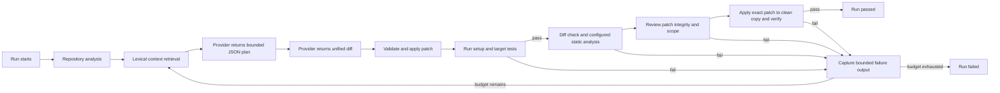
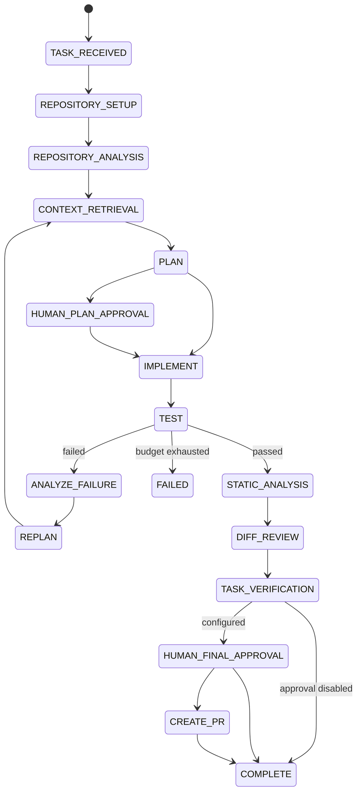

# Agent Workflow

## Current workflow

The implemented workflow is a bounded plan, patch, and verification loop over a clean Git repository. State transitions are validated and persisted together with their audit events:

The state machine records task receipt, workspace setup, repository analysis, context retrieval, plan, implementation, test, static analysis, diff review, task verification, failure analysis/replan, and terminal state. Plans are persisted as concise summaries, steps, and validated repository-relative target files; hidden reasoning is neither requested nor stored. The run requires a clean standalone Git checkout and records its base commit.

Setup and target-test commands run in the same bounded container for each Docker grading attempt; the container is destroyed when grading finishes or times out. Built-in `git diff --check` always runs. Optional `static_analysis_commands` run in a bounded sandbox. The exact recorded patch is applied to a second clean copy and checked using `verification_commands` (or the target-test commands when no separate verifier is configured). Benchmark runs additionally preserve task-owned verification output in their result artifacts.

Each attempt writes `quality_gates.json` with each gate's result and bounded command output. The same gate summaries are recorded in the run event stream so a final verifier result does not hide earlier test or lint evidence.

Plan approval, GitHub pull-request creation, and LangGraph orchestration are not implemented. The provider has a bounded structured tool loop: path-checked file reads/writes, exact replacement, search, directory listing, Git inspection, dependency lookup, and tests/lint/commands through the selected sandbox. File contents are redacted from write-call audit inputs; every tool result is bounded and recorded. Optional final approval is available for API runs when `require_human_approval` is enabled and the server token is configured. Provider output is never success on its own; all configured gates and clean-copy verification must pass.

## Intended state machine

Persist state, retry counters, budgets, decision summaries, and side-effect identities at every transition. Final approval is opt-in and requires a server-side bearer token with at least 32 characters. The decision and state transition are atomic. External publishing actions always require explicit approval. API requests enqueue jobs in SQLite; workers atomically claim and execute them with renewable leases. Expired `running` jobs are marked failed without replay, with stale-owner writes fenced. Resume from the last committed workflow transition remains future work.

## Trace contract

For every transition/tool call, record timestamp, run/step identity, validated input summary, bounded output, duration, error/exit code, and artifact references. Record selected files and selection rationale. Record token and cost usage when available; unknown values remain unknown. Expose concise decision summaries and observable actions, never hidden chain-of-thought.
