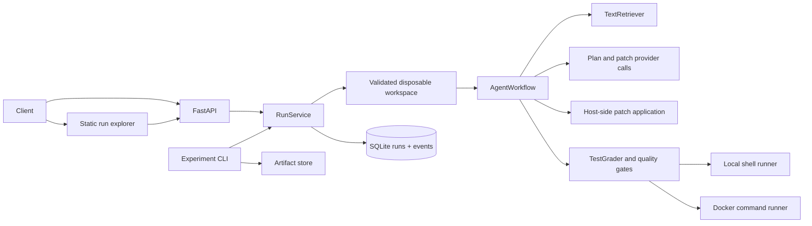
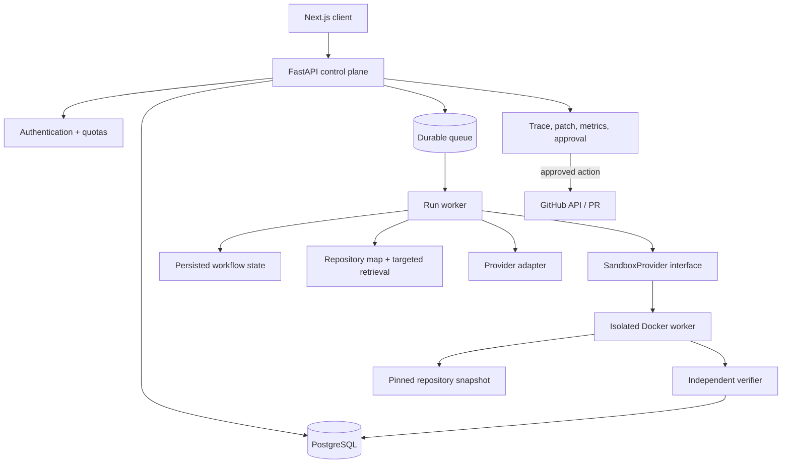

# ForgeBench Architecture

## Current implementation

ForgeBench is currently a single-process FastAPI application. The API delegates run creation to `RunService`; provider selection is handled by the runtime factory. `AgentWorkflow` validates a clean Git base, retrieves bounded text, asks the provider for a structured plan, then runs a bounded structured tool loop or accepts a unified diff. Tool file operations are path-checked; tool commands use the selected sandbox. The workflow runs target tests, static/diff checks, patch review, and exact-patch verification in a second copy. `RunStore` persists run snapshots and append-only events in SQLite. The experiment runner loads a TOML manifest and JSONL tasks, prepares pinned workspace copies, invokes the same service, and stores per-gate artifacts and aggregate output.

The service requires a clean standalone Git repository and records its full base commit before creating separate disposable agent and verifier copies. Generated patch files therefore do not modify the configured source checkout. The local runner is for trusted development only. Docker disables network access and applies resource controls; setup and target tests share one container per attempt. Static-analysis and verifier commands run in their own bounded containers. The host still performs repository copying, diff application, and diff capture; this is defense in depth rather than a complete hostile-code isolation boundary.

## Target production architecture

Keep the present Python service and benchmark concepts. Split control-plane coordination from execution before public arbitrary-repository use. The API validates requests, persists a task and immutable configuration, and enqueues an idempotent run. A worker claims the run and coordinates explicit state transitions. The sandbox provider owns repository materialization, patch writes, command execution, snapshots, and cleanup. The verifier independently checks evaluator-owned tests, integrity, and the final diff. Human approval gates external Git actions.

## State and side effects

The API stores queued requests and idempotency fingerprints in SQLite and returns without running the agent. A separate worker atomically claims the oldest queued run, validates its relative workspace ID against its configured root, and renews a time-limited lease from a heartbeat thread. Workers periodically mark only expired or legacy lease-less `running` jobs failed without replay. Database writes from a worker are fenced by owner and lease expiry so a stale worker cannot overwrite recovered state. This is a durable local queue with leases, but it still fails interrupted runs rather than resuming workflow checkpoints. Approval decisions and terminal transitions are committed together. External actions such as pushing a branch or opening a PR are not implemented; when added, they must require approval and idempotency.

Implemented states include `TASK_RECEIVED`, `REPOSITORY_SETUP`, `REPOSITORY_ANALYSIS`, `CONTEXT_RETRIEVAL`, `PLAN`, `IMPLEMENT`, `TEST`, `ANALYZE_FAILURE`, `REPLAN`, `STATIC_ANALYSIS`, `DIFF_REVIEW`, `TASK_VERIFICATION`, and terminal states. `HUMAN_FINAL_APPROVAL` is optional and available for API runs when configured. Plan approval and `CREATE_PR` remain target states. Retry counts and resource budgets are state data, not implicit loops.

## Data and storage

The prototype stores typed run snapshots, approval decisions, and ordered events in SQLite. The production design should use PostgreSQL with migrations and normalized entities for repositories, tasks, runs, steps, tool calls, patches, test runs, benchmark datasets/tasks/runs, evaluations, model usage, approvals, and failures. Large logs and patches should be immutable object artifacts with content hashes; database records hold identity and references. Dataset definitions and commit pins remain versioned artifacts.

The command execution seam is a `SandboxProvider` protocol with a shared `run`/`destroy` lifecycle. A central factory selects the trusted local runner or the network-disabled Docker runner, and both the agent tools and quality gates use that same boundary. This makes adding another execution backend an explicit adapter change rather than a second set of backend-selection branches.

## Repository understanding

The current deterministic retriever ranks bounded text excerpts by issue-token overlap, adds capped Python AST definition matches for named functions/classes, skips common generated/vendor directories and credential files, and records path, line, score, and selection reason. A bounded repository map reports languages, configuration, entry points, tests, dependency manifests, and command hints. Dependency graph expansion and symbol lookup for other languages remain future work. Retrieval should remain bounded by file, byte, file-count, symbol-file, and token budgets. Embeddings are optional and should only be added when the benchmark demonstrates measurable value.

## Sandbox boundary

Docker has a per-attempt `create`/`execute`/`destroy` lifecycle. The current `SandboxProvider` contract covers bounded command execution and cleanup; file operations and snapshot/restore capabilities are still future extensions. Docker workers receive a read-only source mount, copy it to bounded writable tmpfs, run as a non-root identity, and have no network or provider/GitHub credentials. The Docker daemon remains a powerful host boundary; a stronger VM/firecracker provider can implement the same command lifecycle later.

## Technology decisions

- Keep FastAPI, Pydantic, pytest, and the existing provider/service seams.
- Replace the SQLite local queue with PostgreSQL plus migrations and coordinated worker leases before horizontal scaling.
- Do not add LangGraph solely as a résumé dependency. First implement and test a deterministic state machine; adopt a graph library if branching/resume complexity justifies it.
- Build a Next.js interface after API contracts stabilize; the existing static dashboard is useful for local inspection.
- MCP is optional and should be exposed only for stable interoperability boundaries such as task/run inspection, not as a replacement for internal tool validation.

## Observability

Persist state transition, tool-call, selected-context, command, test, retry, patch, and approval events with timestamps, duration, exit status, bounded output, and redaction. Show concise decision summaries and actions. Never store or display hidden chain-of-thought. Token and cost fields may be unknown; unknown cost is not zero.
