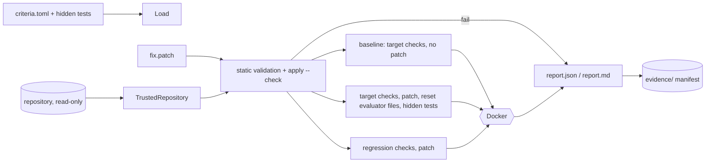

# Tender architecture

Tender is a single Python package (`src/tender/`) with a FastAPI API, a
lease-based queue worker, a CLI, and a zero-build dashboard. State lives in
SQLite and in per-run artifact directories. There are no other services.

## Components

| Module | Responsibility |
| --- | --- |
| `snapshot.py` | Trusted/untrusted repository boundary: sanitized `.git` copies, hardened Git, commit resolution, materializing workspaces from Git objects |
| `integrity.py` | Evaluator ownership: protected paths, restored paths, tool-shadowing rules, hidden evaluator assets |
| `workflow.py` | Agent state machine: retrieval, plan, authorized tool loop, agent-side tests, static analysis, diff review, pristine target/regression verification, stage timing, budgets, outcomes |
| `tools.py` | Typed agent tools with path policy; authorization enforced at dispatch |
| `sandbox.py` | Bounded command execution (local wrapper or Docker container); run-wide `ExecutionBudget` with deadline and cancellation |
| `services.py` | `RunService`: commit-identity policy, snapshot + workspace setup, workflow execution, lease-fenced finalization |
| `store.py` | SQLite runs, events, idempotency, approvals, leases; atomic `finalize_run`; whole-database `aggregate_metrics` |
| `artifacts.py`, `evidence.py` | Staged artifact publication; sanitized, SHA-256-manifested evidence bundles and their verifier |
| `outcomes.py` | `EvaluationOutcome`: separate target, regression, integrity, environment, provider, timeout, policy, overall |
| `patch_eval.py` | `verify-patch`: criteria, patch validation, baseline/target/regression groups, JUnit checks, reports |
| `runner.py`, `experiments.py` | Benchmark manifests and tasks, trial planning, exclusions, quota-aware stopping, summaries, comparisons |
| `worker.py` | Claims queued runs, renews leases, recovers expired runs without replay |
| `api.py` | HTTP API, request limits, security headers, dashboard and report serving |
| `net.py` | Credentialed HTTP without redirects; HTTPS enforcement for provider endpoints |

## Data flow: agent run (API + worker)

```mermaid
sequenceDiagram
  participant Client
  participant API
  participant Store as SQLite
  participant Worker
  participant Snap as TrustedRepository
  participant WF as AgentWorkflow
  participant Box as Docker sandbox
  Client->>API: POST /runs (issue, config, workspace)
  API->>Store: queued run + run.queued
  Worker->>Store: claim (lease)
  Worker->>Snap: copy + sanitize .git, identity()
  Snap-->>Worker: HEAD, dirty?, status digest
  Worker->>Worker: commit policy (reject before any provider call)
  Snap->>WF: materialize agent workspace at commit
  loop attempts
    WF->>WF: retrieve, plan, authorized tools / diff
    WF->>Box: agent-side tests, static analysis
    Snap->>WF: fresh verifier per check
    WF->>Box: target, then regression checks
  end
  WF-->>Worker: result, outcome, timing, verifier evidence
  Worker->>Store: finalize_run: lease check, publish artifacts (rename), final events, run
```

Every event a worker writes is fenced by its lease. If the lease expires, the
next write raises `LeaseLost`, live subprocesses are killed, staged artifacts are
discarded, and recovery fails the run without replaying it.

## Data flow: patch verification



## Trust boundaries

1. **Source repository → Tender process.** Only bytes cross: `.git` is copied
   with symlinks, special files, alternates, and linked worktrees rejected. The
   copy's config is replaced. Git never executes repository-defined helpers on
   the host.
2. **Tender process → workspaces.** Workspaces hold only tracked content at one
   commit. Agent tools cannot reach `.git`, credentials, or evaluator paths.
3. **Workspaces → sandbox.** Commands run in Docker (or, explicitly trusted, on
   the host). Exit codes and bounded output are read by the Tender process.
4. **Tender process → evidence.** Evidence is sanitized and hashed. It is not
   signed.

## Static site

`scripts/build_demo_site.sh` assembles `demo/` (landing page), `demo/replay/`
(the dashboard bundle plus a fetch shim over `records.json`), the shared
`dashboard/` bundle, demo reports, and published experiment JSON. GitHub Pages
serves it under `/Tender/`. All paths are relative.

## Retrieval

`TextRetriever` is a bounded lexical ranker: token overlap with a log-scaled
term bonus, a file-level overlap bonus, and a boost for Python symbol definitions
whose names match the issue. It has no inverse document frequency and no length
normalization, so it is **not BM25**, although historical manifests label it
`bm25` ([erratum E7](EVALUATION_ERRATA.md)).
