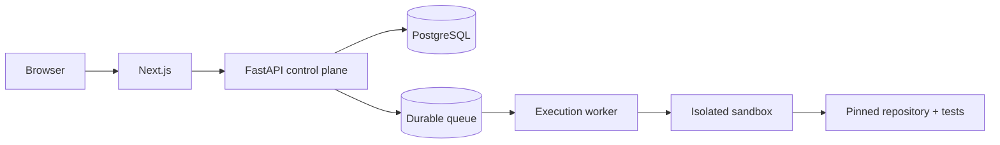

# Deployment

## Current local deployment

The current `docker-compose.yml` builds separate API, worker, and sandbox images. The API image has no Docker CLI or socket. Both services share a host-persisted SQLite database, artifact directory, and curated fixture workspace. The worker alone receives the Docker socket and uses a host-visible temp bind mount so the host Docker daemon can access sandbox source paths. The dedicated sandbox image includes Git for repository tools and is used inside resource-limited attempt containers. This setup is for local development only. Docker socket access grants powerful control over the host and this is not a safe public arbitrary-code execution deployment.
The API port binds to `127.0.0.1` so it is not exposed on the local network by default.

```bash
docker compose up --build
```

Compose mounts local state under `.forgebench-data/`, which is gitignored. The example fixture workspace is mounted read-only at `/workspaces`; use task paths relative to it. The worker needs the host Docker daemon running. Workers heartbeat renewable leases; expired jobs are marked failed without replay, and stale owners cannot commit further run state. The queue can coordinate concurrent claims, though this local Compose example starts one worker by default.

Copy `.env.example` to `.env`; Compose interpolates the listed provider, approval, and GitHub values into only the required service. Never commit `.env`. Never mount the Docker socket into a public API container or a public worker.

## Production target



The control plane and execution plane should scale independently. Workers must not inherit provider, database, or GitHub credentials. Sandbox jobs should be disposable and resource-limited. Use authentication, per-user quotas, curated public demo tasks, and explicit approval for GitHub writes.

The repository does not yet provide production deployment manifests, PostgreSQL migrations, production worker health management, or a public coding execution service. The portfolio page is interactive playback of recorded evidence, but accepts no task and runs no submitted code. Local SQLite-backed worker leases are implemented, but they do not replace production queue/health infrastructure. Do not infer production readiness from the local Compose file. Serverless request execution is not suitable for persistent sandbox workloads.

## Pre-production checklist

- Configure PostgreSQL and migrations, worker leases/health checks, and persistent artifact storage.
- Separate API and worker identities and credentials; do not mount the Docker socket into the API.
- Enforce auth, permissions, rate/concurrency limits, and curated demo restrictions.
- Apply network, CPU, memory, PID, disk, and duration limits to disposable sandboxes.
- Configure TLS, secret management, log redaction/retention, backups, and recovery procedures.
- Run CI/security tests and verify a pinned end-to-end benchmark in the deployment environment.
